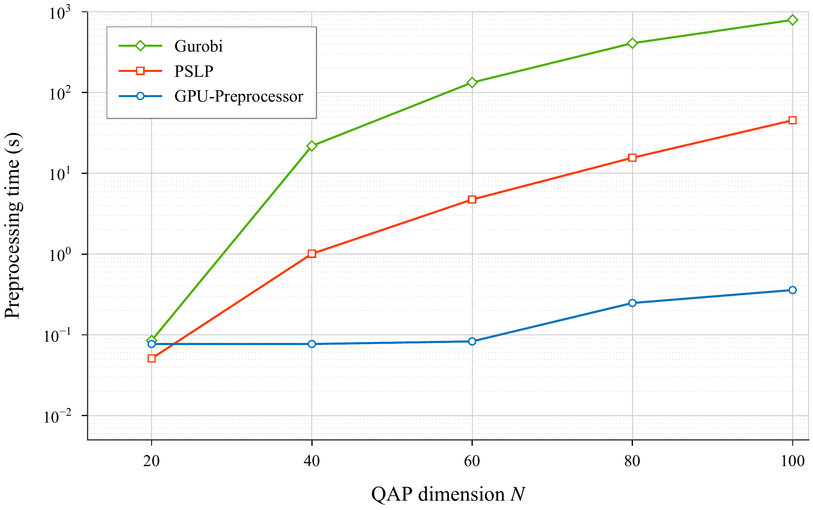

# GPU-Preprocessor

GPU-Preprocessor is a C++/CUDA package for GPU-based LP folding, presolve,
and solution recovery. It reduces a linear program before an external solver
solves it, then recovers a solution in the original model space.

The preprocessor first applies **folding**, then **presolve**. Both stages are
enabled by default. Folding groups rows and variables with matching structure
to form a smaller LP for presolve. After solving, postsolve and unfolding
recover the solution in the original model space.

The package supports continuous linear programs of the form:

```text
minimize    cᵀx + c0
subject to  AL ≤ Ax ≤ AU
             l ≤ x  ≤ u
```

## Installation

Requires Linux, Make, CMake 3.24+, a C++17 compiler, CUDA Toolkit 12+ (nvcc and
cuSPARSE), and an NVIDIA GPU. Run from the project root:

```sh
make
```

This builds the library, command-line tools, and example, automatically selecting
the local GPU architecture.

## Usage

**Command line:**

After building, run the commands below from the project root. Replace `model.mps`
with an uncompressed MPS file for a continuous minimization LP. Integer-marked
inputs are treated as LP relaxations.

```sh
# Run folding followed by presolve and print status, dimensions, and timing
./build/bin/gpu_preprocessor_mps model.mps

# Run presolve only
./build/bin/gpu_preprocessor_mps model.mps --folding false

# Run folding followed by presolve and export the reduced LP
./build/bin/gpu_preprocessor_export_reduced model.mps reduced/
```

The exporter writes `meta.txt` and binary LP data to `reduced/` for an external
solver. Use `--help` to list options.

**C++:** pass a GPU-resident `DeviceLp` to `preprocess`, solve the reduced LP,
then call `postprocess` to recover the original solution:

```cpp
#include "gpu_preprocessor/gpu_preprocessor.hpp"
namespace gpp = gpu_preprocessor;

auto s = gpp::preprocess(lp);
if (!s.presolve.has_infeasible && !s.presolve.has_unbounded) {
    // Solve s.presolve.reduced_lp to obtain device arrays x_red, y_red, z_red.
    auto solution = gpp::postprocess(x_red, y_red, z_red, s, lp);
}
gpp::free_summary(s);
```

`solution.x`, `solution.y`, and `solution.z` are host vectors. See the
[API header](cpp/include/gpu_preprocessor/gpu_preprocessor.hpp) for input and
ownership requirements. Folding and dual recovery have known numerical
limitations; validate the recovered solution against the original LP.

To link from a C++17/CUDA project:

```cmake
add_subdirectory(path/to/GPU-Preprocessor gpu-preprocessor-build EXCLUDE_FROM_ALL)
target_link_libraries(YOUR_TARGET PRIVATE GPUPreprocessor::core)
```

**Example:** [presolve_example.cpp](examples/presolve_example.cpp) demonstrates
preprocessing and recovery on a built-in toy LP. It is built with the main project:

```sh
./build/bin/gpu_preprocessor_example
```

For the MPS tools, [model.mps](examples/model.mps) provides a small input LP.

## Parameters

Set these fields in `gpu_preprocessor::Parameters` when calling the C++ API:

| Parameter | Default | Purpose |
| --- | --- | --- |
| `enable_folding` | `true` | Enable folding before presolve |
| `enable_presolve` | `true` | Enable GPU presolve |
| `max_iters` | `512` | Presolve scheduler iteration budget |
| `max_time` | `∞` | Soft presolve time limit in seconds, checked between phases |
| `enable_structure_specific_rules` | `true` | Enable the five structure-specific reduction families |

Set `enable_folding = false` to run presolve only, or `enable_presolve = false`
to run folding only.
Further tuning fields: [PresolveParams](cpp/include/gpu_presolver/presolve/presolve_structs.hpp).
For a command-line override:

```sh
./build/bin/gpu_preprocessor_mps model.mps --max-iters 20
```

## Performance

The table compares preprocessing time and the percentage of original nonzeros
retained by GPU-Preprocessor, PSLP, and Gurobi Presolve on 49 Mittelmann LPs,
18 large MIPLIB LP relaxations, and 20 QAP-derived LPs (QAP20).
GPU-Preprocessor uses both folding and presolve in these experiments.

Times use a 10-second shifted geometric mean (SGM10); retained percentages are
arithmetic means. Lower is better for both metrics.

| Dataset | Preprocessor | Preprocessing time (s) | Nonzeros retained (%) |
| --- | --- | ---: | ---: |
| **Mittelmann** | Gurobi Presolve | 4.276 | 72.2 |
|  | PSLP | 1.112 | 79.8 |
|  | GPU-Preprocessor | **0.184** | **57.2** |
| **MIPLIB Large** | Gurobi Presolve | 9.903 | 52.5 |
|  | PSLP | 3.214 | 60.8 |
|  | GPU-Preprocessor | **0.292** | **34.2** |
| **QAP20** | Gurobi Presolve | 183.654 | 40.5 |
|  | PSLP | 11.885 | 40.5 |
|  | GPU-Preprocessor | **0.271** | **30.1** |

> **Setup:** GPU-Preprocessor and HPR-LP use one NVIDIA H100 PCIe 80 GB GPU per
> run. PSLP 0.0.11 (full configuration) and Gurobi 12.0.2 (automatic presolve)
> run on the same server's two Intel Xeon Gold 6548Y+ CPUs.
> GPU-Preprocessor's preprocessing time includes folding and presolve.
> All preprocessing times exclude MPS parsing and CPU–GPU transfers of LP data.

Across these groups, GPU-Preprocessor achieves preprocessing-time SGM10 speedups
of **6.0–43.9× over PSLP** and **23.2–677.7× over Gurobi Presolve**, with a
lower mean percentage of nonzeros retained in each group.

The following table compares HPR-LP without preprocessing, with folding alone,
and with each preprocessor on the same benchmark groups.

| Dataset | Method | Solved | Preprocessing (s) | Solve (s) | Total (s) |
| --- | --- | ---: | ---: | ---: | ---: |
| **Mittelmann** | HPR-LP | 46 | 0.000 | 14.456 | 14.456 |
|  | HPR-LP + folding only | 47 | 0.083 | 13.831 | 13.934 |
|  | HPR-LP + Gurobi Presolve | 47 | 4.276 | 8.704 | 13.873 |
|  | HPR-LP + PSLP | 48 | 1.112 | 7.964 | 9.084 |
|  | HPR-LP + GPU-Preprocessor | 49 | 0.184 | 5.615 | **5.797** |
| **MIPLIB Large** | HPR-LP | 17 | 0.000 | 27.322 | 27.322 |
|  | HPR-LP + folding only | 17 | 0.197 | 15.399 | 15.606 |
|  | HPR-LP + Gurobi Presolve | 17 | 9.903 | 10.689 | 20.534 |
|  | HPR-LP + PSLP | 17 | 3.214 | 12.038 | 15.721 |
|  | HPR-LP + GPU-Preprocessor | 17 | 0.292 | 10.407 | **10.666** |
| **QAP20** | HPR-LP | 20 | 0.000 | 33.172 | 33.172 |
|  | HPR-LP + folding only | 20 | 0.147 | 24.995 | 25.207 |
|  | HPR-LP + Gurobi Presolve | 20 | 183.654 | 8.080 | 194.165 |
|  | HPR-LP + PSLP | 20 | 11.885 | 7.934 | 20.220 |
|  | HPR-LP + GPU-Preprocessor | 20 | 0.271 | 6.407 | **6.687** |

> **Setup:** HPR-LP-C 0.1.3 uses a relative KKT tolerance of `1e-6` and a
> 1,000-second solve-time limit, excluding preprocessing. For preprocessed runs,
> solved counts use the reduced LP's stopping criterion. Unsolved runs contribute
> 1,000 seconds to solve-time aggregates. Total time is preprocessing plus solve
> time for each instance, aggregated afterward; it excludes postsolve and
> original-LP validation. The separate SGM10 columns need not add up.

With GPU-Preprocessor, HPR-LP achieves the lowest total-time SGM10 in all three
groups, with **2.5–5.0× speedups over HPR-LP without preprocessing**.
It solves all **49 Mittelmann instances**, compared with 46 without preprocessing
and 47 with folding alone.

For larger problems, we use five QAP LP relaxations derived from `wil100`, with
QAP dimensions from 20 to 100. The largest has **1,980,200 rows, 49,015,000
columns, and 198,020,000 nonzeros**. The figure compares preprocessing times
on a logarithmic scale.



GPU-Preprocessor takes **less than 0.4 seconds** at all five tested sizes.
PSLP is faster at dimension 20; GPU-Preprocessor is faster than both baselines
at dimensions 40–100. At dimension 100, it achieves preprocessing speedups of
**126.3× over PSLP** and **2,207.9× over Gurobi Presolve**, while retaining
**9.4% of the original nonzeros**. With HPR-LP, total time is **9.199 seconds**,
compared with 147.227 seconds using PSLP and 973.876 seconds using Gurobi Presolve.

## License

[MIT](LICENSE).
